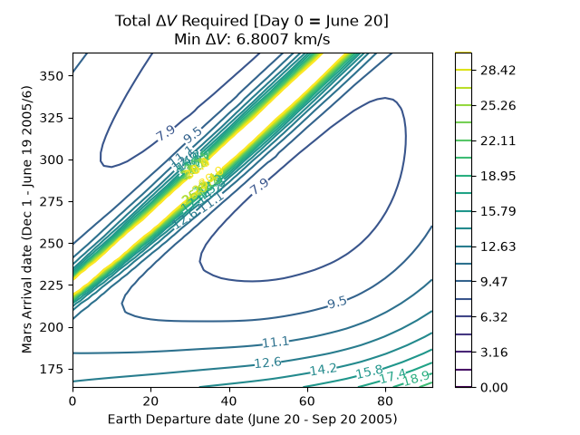

# Orbital Mechanics Toolkit


> A Python library for orbital trajectory design — Lambert problem solving, numerical propagation, porkchop trade studies, and (in progress) attitude determination and proximity operations.


*<Replace with prettiest porkchop plot — Earth–Mars departure/arrival delta-v contours>*

**One-line description + a hero image (your best porkchop or trajectory plot) right at the top, before any text**
**What this does — 2-3 sentences, plain language: Lambert solver, propagator, porkchop trade studies, (eventually) attitude/proximity ops**
**Demo section — for each major capability, a subheading with: 1-2 sentence explanation of the method (e.g. "solves the two-body boundary value problem using a universal-variable formulation") + the resulting plot image + a tiny code snippet showing the API**
**Installation — pip install -e . style, minimal**
**Validation — a short note like "Lambert solver validated against Vallado's worked examples" if you do this; very high-credibility signal in aerospace specifically**
**Roadmap — bullet list: attitude determination (planned), proximity operations (planned) — shows ongoing work, not abandoned project**
**License**
---

## What this does

This toolkit implements core algorithms used in interplanetary mission design:

- **Lambert's problem solver** — computes the transfer orbit (and required velocity) connecting two position vectors in a given time of flight
- **Numerical orbit propagator** — integrates the equations of motion to plot spacecraft trajectories over time
- **Porkchop plot generator** — sweeps departure/arrival date combinations to visualize delta-v cost and identify optimal launch windows
- **Extended Kalmann Filter** *(planned)* — combines measured state data with projected state date to determine "true" state
- **Attitude determination** *(planned)* — estimates spacecraft orientation from sensor data
- **Proximity operations** *(planned)* — relative motion modeling for rendezvous and docking scenarios

---

## Demo

### Lambert Solver

Brief description of the method (e.g. universal variable formulation, iteration scheme, what inputs/outputs look like).

```python
from orbitkit.lambert import solve_lambert

v1, v2 = solve_lambert(r1, r2, tof, mu=MU_SUN)
```


---

### Trajectory Propagation

Brief description (integrator type, perturbations included/excluded, frame assumptions).

```python
from orbitkit.propagation import propagate

trajectory = propagate(state0, t_span, mu=MU_EARTH)
```


---

### Porkchop / Delta-V Trade Studies

Brief description (what's being swept, what the color contours represent).

```python
from orbitkit.porkchop import generate_porkchop

generate_porkchop(departure_range, arrival_range, body1="Earth", body2="Mars")
```


---

### Extended Kalmann Filter *(planned)*

Brief description once implemented.

---

### Attitude Determination *(planned)*

Brief description once implemented (e.g. TRIAD, QUEST, or Kalman filter approach).

---

### Proximity Operations *(planned)*

Brief description of intended scope (e.g. relative motion in Hill/Clohessy-Wiltshire frame, docking approach trajectories).

---

## Installation

```bash
git clone https://github.com/YOUR_USERNAME/orbital-mechanics-toolkit.git
cd orbital-mechanics-toolkit
pip install -e .
```

**Requirements:** Python 3.x, NumPy, SciPy, Matplotlib *(adjust to your actual dependencies)*

---

## Validation

Notes on how correctness was checked, e.g.:

- Lambert solver verified against worked examples from Vallado, *Fundamentals of Astrodynamics and Applications*
- Propagator cross-checked against known analytical two-body solutions (e.g. circular orbit period, energy conservation)

Run the test suite:

```bash
pytest tests/
```

---

## Roadmap

- [x] Lambert's problem solver
- [x] Numerical trajectory propagator
- [x] Porkchop plot / delta-v trade study generator
- [ ] Attitude determination
- [ ] Proximity operations / relative motion modeling
- [ ] Interactive Streamlit demo

---

## Project Structure

```
orbital-mechanics-toolkit/
├── src/orbitkit/        # core library
├── tests/               # unit tests validating solvers
├── examples/            # standalone runnable scripts
├── notebooks/           # narrated walkthroughs with plots
└── docs/images/         # plots referenced in this README
```

---

## License

This project is licensed under the MIT License — see [LICENSE](LICENSE) for details.
