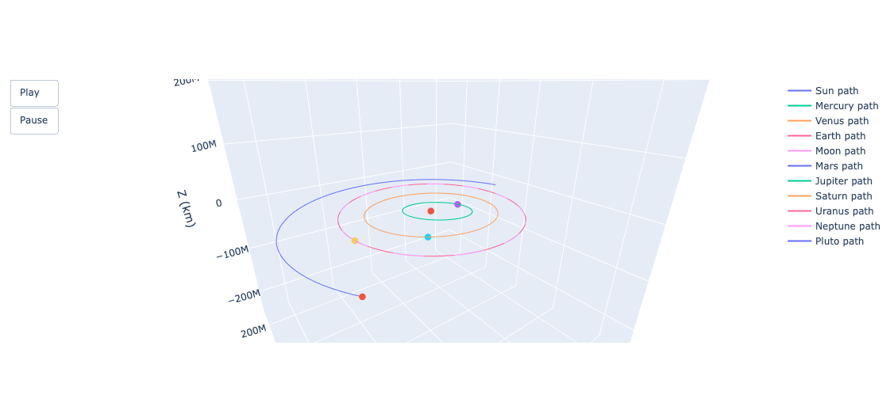
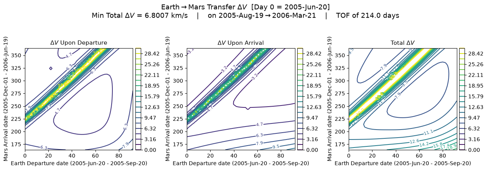

# Orbital Mechanics Toolkit


*Earth–Mars transfer Δv — darker contours require less Δv. Min: 6.80 km/s, Aug 19 2005 → Mar 21 2006 (214-day transfer)*

**A Python library for orbital trajectory design — Lambert problem solving, numerical propagation, porkchop trade studies, with (planned) orbit determination, Kalman filtering, proximity operations, and attitude determination.**

---

## Contents

- [What this does](#what-this-does)
- [Demo](#demo)
- [Installation](#installation)
- [Project Structure](#project-structure)
- [Validation](#validation)
- [Known Limitations](#known-limitations)
- [Roadmap](#roadmap)
- [License](#license)

---

## What this does

This project provides tools that can be used to aid in trajectory design, including a Lambert's problem solver paired with a porkchop plotter, and a numerical integrator to verify and visualize solutions. There will eventually be tools included to handle orbit determination with Kalman Filtering, attitude determination and proximity operations.

- **Lambert's problem solver** — computes the transfer orbit (and required velocity) connecting two position vectors in a given time of flight using Lambert's Theorem
- **Porkchop plot generator** — sweeps departure/arrival date combinations to visualize delta-v cost and identify optimal launch windows
- **Numerical orbit propagator** — integrates basic gravitational equations of motion to plot spacecraft trajectories over time
- **Orbit Determination (Batch Least Squares)** *(planned)* — estimates a spacecraft’s initial position and velocity from simulated tracking measurements, such as range and range-rate, by iteratively fitting the propagator’s predicted measurements to the data
- **Extended Kalman Filter** *(planned)* — fuses measurement data with the propagator's dynamics model to estimate true position/velocity (sequential orbit determination); designed to be reusable for attitude estimation later
- **Proximity operations** *(planned)* — relative motion modeling for rendezvous and docking scenarios
- **Attitude determination** *(planned)* — estimates spacecraft orientation from sensor data (will build on the EKF above)

---

## Demo

### Lambert Solver

Uses Lambert's Theorem to calculate transfer arc between 0 and 360 degrees, not including 180 or 360 degrees.

```python
from orbitkit.lambert import lambert, norm

# Earth → Mars transfer, departing 2022-01-01, arriving 2022-05-01
earth_state = [1.39714e8, 5.24330e7, -2.69070e3, -10.96076, 27.77178,  -6.74710e-4]
mars_state = [-1.021116e8, 3.32397e7, 6.34862e6, -11.00778, -33.46124, 0.17587]
time_of_flight = (2459621.5 - 2459501.5) *24 *3600 # [seconds]
muSun = 1.32712428e11 #[km^3/s^2]

(v1_transfer, v2_transfer, _) = lambert(earth_state[:3], mars_state[:3], time_of_flight, muSun)
dv1_transfer = norm(v1_transfer - earth_state[3:])
dv2_transfer = norm(mars_state[3:] - v2_transfer)
dv_total = dv1_transfer + dv2_transfer

print(f"Total delta-v: {dv_total:.3f} km/s")
```


### Trajectory Propagation

N body point-mass numerical integrator using solve_ivp with method='RK45' or 'DOP853'

```python
from orbitkit.constants import planet_params
from orbitkit.propagator import propagate
from orbitkit.plotting import plot_plotly

# Load default solar-system bodies with initial pos/vel/mass from horizons data on 01-Jan-2026
orbital_bodies = planet_params()

# Propagate all bodies for 1 year
tspan = (0, 365 * 24 * 3600)   # [s]
orbital_bodies = propagate(orbital_bodies, tspan, show_progress=True)

# Try zoom_radius=6e9 to see pluto
plot_plotly(orbital_bodies, focus_body='Sun', zoom_radius=2.5e8, animate=True)

```




### Porkchop / Delta-V Trade Studies

Uses lambert solver to calculate transfer arcs and dV required between a departure and arrival window. Plots a contour grid (porkchop plot) where contours represent dV required and axes are departure and arrival dates.

```python
from orbitkit.ephem_io import parse_horizons_csv
from orbitkit.porkchop_plotter import porkchop_grid_calculation, plot_porkchops
from orbitkit.lambert import lambert

mu_sun = 1.32712428e11  # [km^3/s^2]

# Run this from the root directory /orbitaltoolkit/ 
# Load Earth/Mars ephemeris over a departure/arrival window (see docs/examples/)
earth_data = parse_horizons_csv("docs/examples/HW6_Ephem_Earth.txt")
earth_data.name = "Earth"
mars_data = parse_horizons_csv("docs/examples/HW6_Ephem_Mars.txt")
mars_data.name = "Mars"

dv1, dv2 = porkchop_grid_calculation(earth_data, mars_data, mu_sun, lambert)
plot_porkchops(earth_data, mars_data, dv1, dv2)

```



### Orbit Determination (Batch Least Squares) *(planned)*

Simulates tracking measurements, starting with range and range-rate from a tracking station, for a spacecraft propagated with the toolkit’s dynamics model, adds measurement noise, and uses batch least squares to recover the spacecraft’s initial position and velocity (6 states). Results will be compared against the known truth trajectory.

### Extended Kalman Filter *(planned)*

Sequentially estimates the same 6-element position and velocity state, using the point-mass propagator as the dynamics model and the same simulated measurements as the batch estimator, so the two methods can be compared on identical data. Designed to be reusable for attitude estimation later.

### Proximity Operations *(planned)*

Relative motion modeling between a chaser and a target spacecraft, starting with the Clohessy–Wiltshire equations in a Hill frame. Maneuver and station-keeping capability may follow.

### Attitude Determination *(planned)*

Estimates spacecraft orientation from sensor data. Candidate approaches include TRIAD, QUEST, and Kalman filtering; the method has not yet been selected.

---

## Installation

```bash
git clone https://github.com/qgarton/orbitaltoolkit.git
cd orbitaltoolkit
pip install -e .        # core library only
pip install -e ".[dev]" # optional: adds pytest and notebook support
```

**Requirements:** Python 3.9+, NumPy, SciPy, Matplotlib, plotly, requests

---

## Project Structure

```
orbitaltoolkit/
├── src/orbitkit/        # core library
├── tests/               # unit tests validating solvers
├── examples/            # standalone runnable scripts
├── notebooks/           # narrated walkthroughs with plots
└── docs/
    ├── images/         # plots referenced in this README
    ├── tests/           # .txt files used for tests
    └── examples/        # .txt files used for examples
```

---

## Validation

The Lambert solver is checked against multiple independent sources to catch 
both numerical and branch-selection errors:

- **Textbook examples** — verified against worked problems from Curtis, 
  *Orbital Mechanics for Engineering Students* (Ex. 5.2), and Battin, 
  *An Introduction to the Mathematics and Methods of Astrodynamics* 
  (Problem 7-12, AU/year units — a check against unit-scale bugs)
- **Coursework problems** — cross-checked against hand-calculated 
  Earth–Venus transfer values from ASEN 5050 (CU Boulder)
- **Transfer branch coverage** — includes both short-way (<180°) and 
  long-way (>180°) transfer angle cases, including a zero-maneuver 
  edge case for catching branch-selection bugs

Porkchop grid calculations were checked against ASEN 5050 (CU Boulder) 
coursework, with a one-off manual comparison against GMAT-generated 
trajectories; an automated synthetic-data regression test is in progress.

Propagator cross-checked against JPL Horizons ephemeris data over a 1-year 
period: position and velocity error assert under 2% for all bodies, 
including Mercury and Pluto (the most dynamically sensitive, as expected).

Run the test suite (requires dev dependencies — see Installation):

```bash
pytest
```

---

## Known Limitations

- Lambert solver does not currently handle transfer angles at or near 180° (singular geometry case) — trajectories requiring near-180° transfers will fail or return invalid results
  - Can create new Lambert solver using a different method which can handle those cases. Has the potential to also handle parabolic/hyperbolic transfers, and/or multirevolution transfers

- Porkchop plotter inherits the same 180°-transfer limitation as the Lambert solver — grid points near this transfer angle will be missing or invalid; fixable by implementing an alternate Lambert formulation for that regime

- Propagator only takes into account point mass gravitational effects. Has no collision avoidance/modeling, no drag, no J2 effects, and no SRP.

---

## Roadmap
- [x] Lambert's problem solver (Lambert's Theorem)
- [x] Numerical trajectory propagator
- [x] Porkchop plot / delta-v trade study generator
- [ ] Orbit Determination (batch least squares)
- [ ] Extended Kalman Filter (sequential orbit determination)
- [ ] Proximity operations / relative motion modeling
- [ ] Attitude determination

### Nice to Haves
- [ ] Lambert's problem solver (Universal Variable, Izzo's, or Battin's)
- [ ] Symplectic integrator to conserve energy/angular momentum (rebound, leapfrog/verlet)
- [ ] Interactive Streamlit demo

---

## License

This project is licensed under the MIT License — see [LICENSE](LICENSE) for details.
